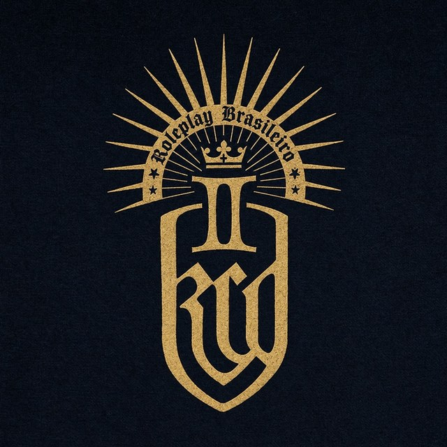

<p align="center">
  
</p>

# Kingdom RP Brasil

Servidor de roleplay medieval para Kingdom Come: Deliverance II, rodando em cima do KCDC (Kingdoms Connected), o mod que deixa o jogo ter servidor dedicado. Aqui está o que a gente escreveu para ele: o gamemode em TypeScript, os dados, os mapas exportados do World Builder e a documentação de tudo.

O jogo e os binários do KCDC não estão neste repositório. Você baixa o KCDC à parte e este repositório entra por cima (o passo a passo está logo abaixo). O site do servidor é o kingdomrpbrasil.com.br.

O mapa em uso é o de Trosky. Boa parte do conteúdo mais antigo (cidades, vendedores, cocheiros, barbeiros) foi feita para Kuttenberg e só liga quando o nível do `server.json` é `kutnohorsko`. Em Trosky, quem decide onde as coisas ficam é a administração, pelo painel e pelo World Builder.

## O que tem aqui

```
resources/kcdc-gamemode/   o gamemode: src/server, src/client, ui-src (as páginas), data, tools, tests, stream
resources/ddv-*/           três mods de KCD2 (correção de roupa) instalados como recursos do servidor
worlds/                    exportações do World Builder: quadros de aviso, portas, móveis
*.md                       documentação: comandos, NPCs, itens, armaduras, passivas, balanceamento
assets/                    a imagem do brasão que está lá em cima
```

O `.gitignore` deixa de fora `client/`, `server/`, `server-linux/` (o KCDC), `playerdata/` e `secrets/` (dados e senhas de um servidor rodando), `node_modules/` e `dist/`.

## O que você precisa

- Uma máquina para o servidor: Windows, ou Linux. Em Linux o servidor usa as bibliotecas do sistema: libcurl, OpenSSL 3, zlib e libstdc++. No Ubuntu 24.04 são `libcurl4t64 libssl3t64 zlib1g libstdc++6`.
- O KCDC 1.8.1, que vem num arquivo com `client/`, `server/` e `server-linux/`. Servidor e jogadores têm que usar a mesma versão, senão a entrada fica pendurada na tela de carregamento e cai. Os releases ficam no projeto Kingdoms Connected (github.com/kingdomsconnected e mafiahub.dev).
- Node.js 22 ou mais novo, só na máquina onde você compila. O servidor leva o próprio runtime e não precisa de Node para rodar. A gente usa o 24.
- O jogo (Kingdom Come: Deliverance II) instalado, para pegar um arquivo dele (o `recast.pak`, passo 4). Quem joga precisa da cópia da Steam: o personagem é guardado pelo Steam ID, e conta sem Steam é recusada na porta.

## Subindo o servidor

Nos exemplos, `$S` é a pasta do servidor dentro do KCDC: `server-linux/` no Linux, `server/` no Windows.

### 1. Desempacotar o KCDC

Descompacte o arquivo do KCDC em qualquer lugar. Não copie arquivos soltos de dentro dele: o launcher dos jogadores se atualiza com base na pasta inteira. Fora a pasta do servidor, você não precisa mexer em mais nada do KCDC.

### 2. Compilar o gamemode

```sh
git clone https://github.com/MauroAlvess/kcd_2_server.git
cd kcd_2_server/resources/kcdc-gamemode
npm ci
npm run build
```

O build compila as duas metades (servidor e cliente), enxuga o cliente e empacota as páginas de `ui-src/` em `ui/`. Sem esse passo o servidor sobe mas ignora o gamemode, e nenhum comando responde. Se quiser conferir antes de subir, `npm test` roda mais de dois mil e quinhentos testes e leva uns dois minutos.

### 3. Copiar para a pasta do servidor

O gamemode do KCDC que vem no release tem o mesmo nome do nosso e precisa ser trocado. Copie sem a pasta `node_modules`.

```sh
# Linux
rsync -a --delete --exclude node_modules resources/kcdc-gamemode/ $S/resources/kcdc-gamemode/
cp -r resources/ddv-* $S/resources/
cp -r worlds $S/
```

```bat
:: Windows
robocopy resources\kcdc-gamemode %S%\resources\kcdc-gamemode /E /XD node_modules
robocopy resources\ddv-bascincoif-fix-m %S%\resources\ddv-bascincoif-fix-m /E
robocopy resources\ddv-underwfix-m %S%\resources\ddv-underwfix-m /E
robocopy resources\ddv-underwfix-bath %S%\resources\ddv-underwfix-bath /E
robocopy worlds %S%\worlds /E
```

O servidor não lê as fontes em TypeScript, só `dist/`, mas a pasta `ui/`, `data/` e `stream/` também precisam estar lá. `stream/` guarda a figura que fica sobre os quadros de aviso (um modelo e uma textura que o servidor manda para os jogadores junto com o resto).

### 4. O navmesh de Trosky

Sem o navmesh os NPCs andam em linha reta e atravessam parede (o servidor avisa no log). Ele é do jogo, não vem com o KCDC. Copie o arquivo do nível para a pasta do servidor, mantendo o nome:

```
Kingdom Come Deliverance II/Data/Levels/trosecko/recast.pak   ->   $S/files/trosecko/recast.pak
```

Na Steam, a pasta do jogo costuma ser `C:\Program Files (x86)\Steam\steamapps\common\KingdomComeDeliverance2`. Depois de uma atualização do jogo, copie de novo.

### 5. server.json

O servidor escreve um `server.json` com tudo no padrão na primeira vez que sobe. Pare o servidor antes de editar (ele só lê o arquivo no início) e mexa só no que precisa:

```json
{
  "host": "0.0.0.0",
  "port": 27015,
  "maxplayers": 100,
  "password": "uma-senha-sua",
  "server-token": "",
  "mod": {
    "level": "trosecko",
    "scoreboard": false,
    "world_resources": ["worlds/quadros-trosky.world.json"]
  }
}
```

`level` é o mapa. `password` é a senha do mundo, que todo mundo digita para entrar (vazia deixa qualquer um entrar). `scoreboard: false` desliga a lista do Tab para os jogadores; a administração vê quem está online no painel (F3). `world_resources` lista as exportações do World Builder que o servidor carrega; para Trosky é só a dos quadros. `server-token` só serve para aparecer na lista de servidores do jogo (se registra em mafiahub.dev); vazio, o servidor não é listado e se entra pelo endereço.

Quanto ao `maxplayers`: o limite de verdade é o processador. Numa VPS de 3 vCPU a gente começa a sentir o servidor pesado perto de 50 jogadores, mesmo com a folga de memória.

Para subir o mapa de Kuttenberg em vez do de Trosky, troque o `level` por `kutnohorsko` e use `worlds/quadros-de-aviso.world.json`, `worlds/raborsch.world.json` e `worlds/portas-removidas.world.json`.

### 6. Primeira subida

Sempre de dentro da pasta do servidor, porque ele lê `server.json` e `resources/` do diretório onde foi iniciado:

```sh
cd $S
./KCDCServer            # no Windows: .\KCDCServer.exe
```

Espere a linha `KCDC Server successfully started` e as linhas que começam com `[kcdc-gamemode]`. Se só a primeira aparecer, falta o `dist/` do gamemode (volte ao passo 2). Para ver se está de pé sem abrir o jogo:

```sh
curl http://127.0.0.1:27015/
```

Responde um JSON com a versão, o nível e o número de vagas.

Na primeira subida com um mapa novo o servidor cataloga sozinho as casas, os baús e os armários (começa uns vinte segundos depois de subir e leva uns dois minutos). O resultado vai para `playerdata/properties.json`; o log mostra cada propriedade que encontrou. Não é erro, é o servidor se ajeitando.

Parar: Ctrl+C ou `quit` no console. Os personagens são gravados na saída.

### 7. Quem pode entrar

Tem três trancas, e a segunda importa mais do que parece.

A senha do mundo está no `server.json` (passo 5).

Os tickets definem quem é jogador e quem é administrador. Rode na pasta do servidor, com o mesmo usuário que roda o servidor (senão ele não consegue ler o arquivo que o script gravou):

```sh
cd $S
node resources/kcdc-gamemode/scripts/auth.mjs init            # cria secrets/auth.json e mostra dois tickets, uma única vez
node resources/kcdc-gamemode/scripts/auth.mjs add admin maria # um ticket de administrador com o rótulo "maria"
node resources/kcdc-gamemode/scripts/auth.mjs revoke maria
node resources/kcdc-gamemode/scripts/auth.mjs list
node resources/kcdc-gamemode/scripts/auth.mjs enforce on      # quem não tem ticket válido deixa de entrar
```

Um ticket tem a forma `rotulo.segredo` e o segredo só aparece na hora em que é criado: o arquivo guarda apenas o hash. Anote na hora. **Enquanto `secrets/auth.json` não existir, todo mundo que entra é administrador.** Não esqueça disso ao abrir o servidor para fora. Se a máquina do servidor não tem Node, rode o script no seu computador (com `KCDC_AUTH_FILE` apontando para um arquivo seu) e envie o `secrets/auth.json` para a pasta do servidor.

A lista de contas aprovadas (whitelist) é opcional e funciona do mesmo jeito:

```sh
node resources/kcdc-gamemode/scripts/whitelist.mjs add 7656119XXXXXXXXXX "Nome"   # Steam ID de 17 dígitos, ou o link steamcommunity.com/profiles/...
node resources/kcdc-gamemode/scripts/whitelist.mjs list
node resources/kcdc-gamemode/scripts/whitelist.mjs enforce on
```

Com `enforce` desligado ela só anota no log quem teria sido recusado, e dá para ir enchendo a lista com calma antes de ligar. Link de perfil com nome (`steamcommunity.com/id/nome`) não serve, porque não traz o número.

Tanto os tickets quanto a lista são lidos a cada entrada: não precisa reiniciar nada.

### 8. Abrir as portas

A porta 27015 em UDP é o jogo. A partir do KCDC 1.8 a página de status também usa a 27015, em TCP. Abra as duas. No Ubuntu:

```sh
sudo ufw allow 27015/udp
sudo ufw allow 27015/tcp
```

Em casa, atrás de roteador, é a mesma coisa em redirecionamento de portas, e a maior fonte de "ninguém consegue entrar" é redirecionar a porta no protocolo errado. Para testar de fora, peça a alguém para abrir `http://seu-endereço:27015/`: se aparecer o JSON, o TCP está certo; se mesmo assim não entra, olhe o UDP.

### 9. Entrando no servidor

Cada jogador desempacota o KCDC (a pasta `client/`), abre a Steam, roda `client/KCDCLauncher.exe` e usa **Conexão direta** com o endereço, a porta 27015 e a senha do mundo.

O menu do jogo não tem campo para ticket, então todo mundo entra como jogador comum. Para virar administrador, depois de dentro, digite no chat (T):

```
/admin rotulo.segredo
/admin sair          (volta a ser jogador comum até sair do servidor)
```

Quem quiser pular o menu pode abrir o launcher com um link:

```
KCDCLauncher.exe "kcdc://endereço?nickname=Fulano&password=a-senha&ticket=rotulo.segredo"
```

Faça isso num atalho (`.lnk`) apontando direto para o launcher. Um `.bat` que chama `cmd` com `start` já travou o jogo no menu, e não adianta insistir. O link leva a senha e o ticket em texto, então atalho com ticket de administrador não se compartilha nem se sobe para o GitHub.

## Em produção (VPS)

Um exemplo de unidade do systemd, com o servidor rodando num usuário comum:

```ini
[Unit]
Description=Kingdom RP Brasil (KCDC)
After=network.target

[Service]
User=kcdc
WorkingDirectory=/opt/kcdc/server-linux
ExecStart=/opt/kcdc/server-linux/KCDCServer
Restart=on-failure
LimitNOFILE=65536

[Install]
WantedBy=multi-user.target
```

O que precisa de backup é a pasta do servidor inteira, mas o que não se refaz é: `playerdata/` (personagens, propriedades, regiões, cidadania, cartas, tudo o que os jogadores construíram), `secrets/`, `server.json` e `files/`. Ao trocar a pasta do servidor por uma versão nova do KCDC, leve essas quatro junto. Sem `secrets/` o servidor volta ao modo aberto.

Para atualizar o gamemode: compile no seu computador (a VPS não precisa de Node), copie por cima como no passo 3 e reinicie o servidor. Dá para recarregar só o recurso com `ensure kcdc-gamemode` no console do servidor, e serve para testar, mas na prática a gente sempre reiniciou o servidor inteiro, avisando os jogadores antes.

Uma armadilha que já custou caro: tudo o que o servidor manda para o jogador ao entrar (os scripts de cliente e a pasta `ui/`) vai num pacote só, e acima de uns 510 KB o download travou a tela de carregamento de todo mundo, sem erro em lugar nenhum. O pacote é mantido abaixo de 480 KB e há um teste que falha se passar (`tests/packagesize.test.cjs`). A figura dos quadros de aviso e os mods de KCD2 seguem outro caminho (asset paks) e não contam nesse limite.

## Usando o servidor

### Como jogador

Na primeira entrada a pessoa responde às perguntas sobre as regras e monta o personagem (nome, alcunha, rosto, corpo, idade, altura, roupas). Depois entra no mundo. O que dá para usar:

- **T** abre o chat (local nas vilas e cidades, com comandos). **H** é a voz, segurando. **G** abre os gestos. **E** interage (portas, baús, NPCs). **F** abre os quadros de aviso e acende o fogo.
- **F2** abre o painel: personagem, guildas, família, cartas, propriedades, animais, nomeação, apoiador e opções.
- Oito guildas (ferreiro, alquimista, taberneiro, caçador, artesão, coletor, agricultor e domador), cada uma com os seus ofícios, receitas e limites diários de ganho. Quem não é da guilda não usa a forja, a mesa de alquimia ou o defumador.
- Os quadros de aviso têm duas abas: cartazes (10 moedas, ficam sete dias) e Cidadania, que mostra a cidade do lugar (brasão, quem manda, população, guerra) e onde o jogador se torna cidadão. Quem morre acorda na cidade de que é cidadão.
- Propriedades têm dono e chave; as terras de cada região têm um senhor, e os títulos (cavaleiro, burgomestre e outros) são dados por quem tem autoridade, na seção de nomeação.

### Como administrador

Entre com um ticket de administrador (passo 9). O **F3** abre a Administração: jogadores, chaves e terras, NPCs, entre outras. As tarefas de sempre:

- Dar as terras de uma região a um jogador (ele vira o senhor): Chaves, Terras.
- Posicionar NPCs: na seção NPCs do F3 cada vendedor tem um número e o comando para colocá-lo onde você está parado, como `/mercador aqui <numero>`; `/barbeiro aqui <numero>` faz o mesmo com os barbeiros.
- Colocar objetos e quadros de aviso: no World Builder do jogo (`/builder` libera para você, F7 abre; ele também funciona offline, no seu próprio jogo). Exporte o projeto para um `.world.json`, ponha o arquivo em `worlds/` e liste-o em `world_resources`. Os quadros de aviso são reconhecidos pelo marcador enterrado na base de cada um (veja `src/server/mural-places.ts`).
- Moderação e acompanhamento: `/mural lista`, `/cidadania`, `/entrada`, `/nivel`, `/oficios`, `/propriedade` e os outros comandos que `/help` lista para quem é administrador.

A referência completa de comandos, teclas e painéis está em `COMANDOS.md`.

Uma coisa a saber sobre o estado de Trosky: o servidor foi reiniciado do zero no mapa novo, e os vendedores de guilda, barbeiros e cocheiros ainda precisam ser posicionados por quem administra. Os quadros de aviso, as regiões, as cidades e as casas já estão mapeados.

## Mexendo no código

O gamemode é um recurso do KCDC como qualquer outro (`resources/kcdc-gamemode/package.json` diz quais arquivos o servidor roda e quais o cliente recebe). Para trabalhar:

```sh
cd resources/kcdc-gamemode
npm ci
npm run dev        # recompila ao salvar; depois reinicie o recurso ou o servidor
npm test           # compila e roda todos os testes
```

Algumas regras que a gente aprendeu do jeito difícil:

- As páginas da interface se editam em `ui-src/`. A pasta `ui/` é gerada pelo build, e há um teste que confere que ela está igual ao que as fontes dizem.
- Os testes carregam o código compilado de `dist/`, então rode o build antes se for só `node --test`.
- As imagens do painel não vão no pacote do cliente: ficam em `data/ui-images.json` e o servidor manda quando a página pede. `tools/make-ui-images.py` gera esse arquivo.
- A figura dos quadros de aviso (`stream/`) é gerada por `tools/make-board-sign.py` a partir de uma imagem sua (`--image`) e de arquivos do próprio jogo, que ele lê direto dos `.pak` da instalação (`--game` aponta a pasta `Data`). Precisa do Pillow.
- O código que depende de coordenadas de Kuttenberg fica atrás de `onKuttenberg()` em `src/server/level.ts`. Um nível novo precisa de regiões, cidades e lugares do mapa próprios (veja `TROSKY_REGIONS`, `TROSKY_TOWNS` e `map-places-data-trosecko.ts`).

## Documentação

| Arquivo | O que tem |
| --- | --- |
| `COMANDOS.md` | todos os comandos, teclas e painéis, e como cada sistema funciona |
| `NPCS.md` | os NPCs, onde ficam e o que vendem |
| `ITENS.md`, `ARMADURAS.md`, `CONJUNTOS-HISTORICOS.md` | itens, armaduras e conjuntos |
| `PASSIVAS.md` | as passivas e as que ficam bloqueadas |
| `BALANCEAMENTO.md`, `SINERGIA.md` | o balanceamento dos ofícios e como as guildas se alimentam |
| `MODS.md` | os mods de KCD2 que o servidor manda aos jogadores e como pôr outro |

A documentação oficial do KCDC (API de scripts, World Builder, opções do servidor) está em github.com/kingdomsconnected/docs.

## Créditos e uso

Este projeto foi feito em cima do Kingdom RP Brasil. Pode usar, copiar e modificar o que está aqui; a única regra é dizer, onde o seu servidor ou o seu projeto aparecer, que ele foi feito em cima do Kingdom RP Brasil.

O KCDC (o cliente e o servidor) é do projeto Kingdoms Connected, e o gamemode partiu do gamemode padrão deles. Kingdom Come: Deliverance II é da Warhorse Studios. Os três recursos `ddv-*` são mods do DDVaMpZzz (Nexus Mods, mod 1766), instalados como estão.
